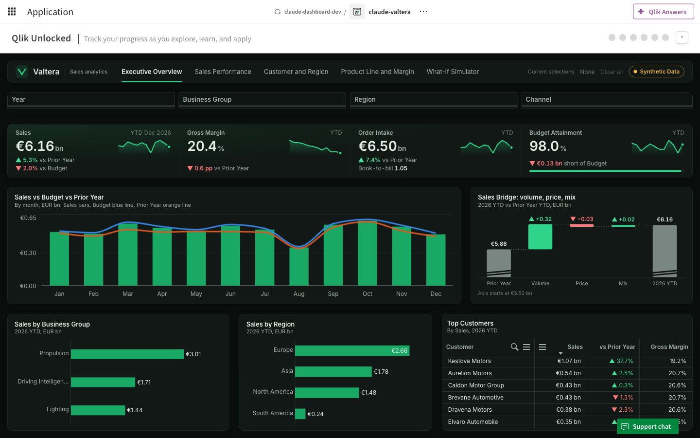
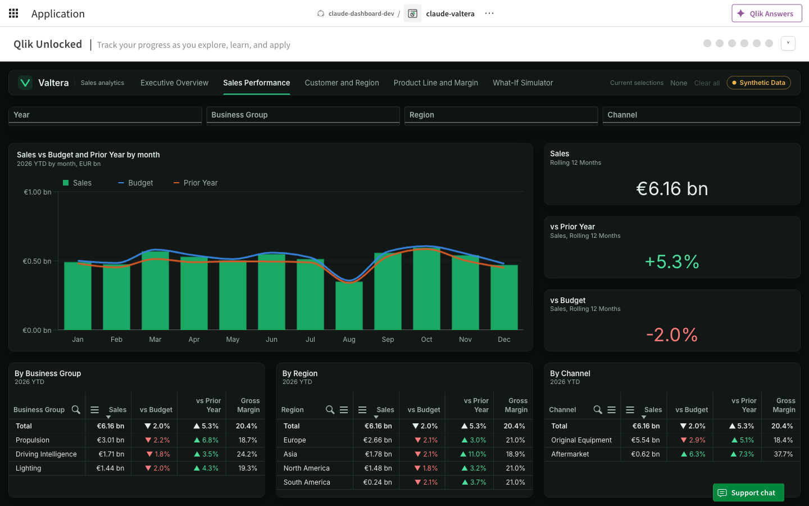
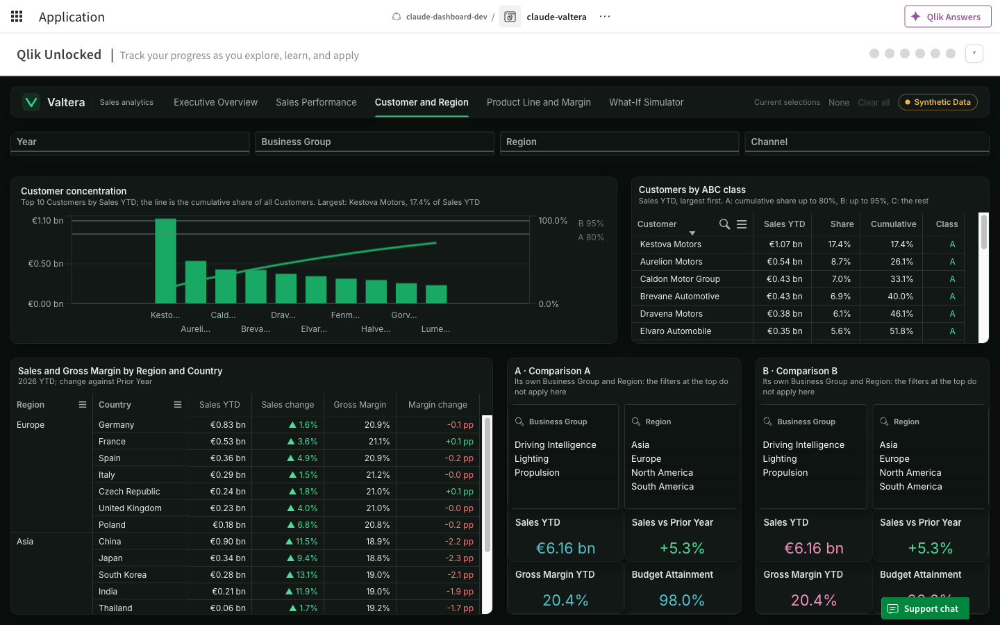
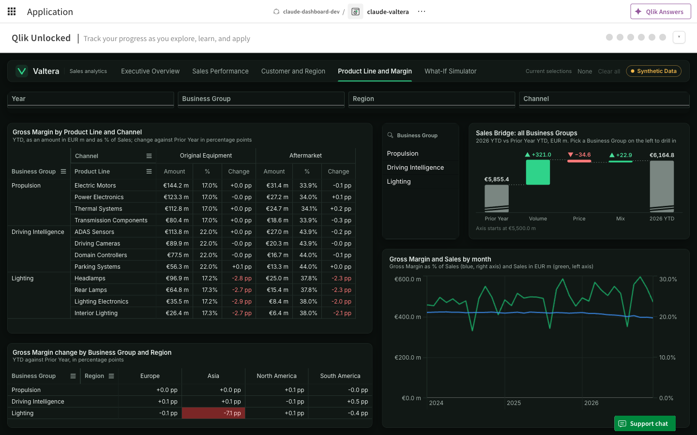
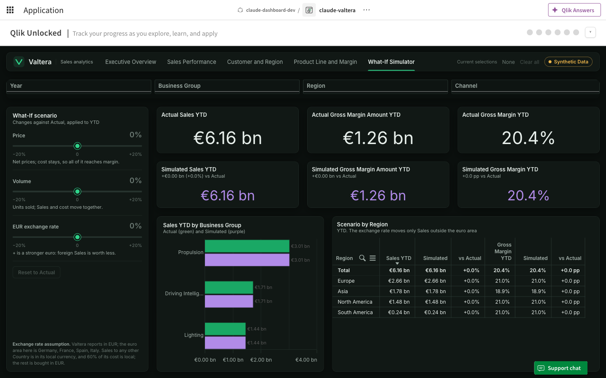

# Valtera Sales Dashboard

> **All data in this repository is Synthetic Data.** It is generated by `valtera/data.py` from a fixed seed. Valtera is a fictional automotive supplier, and every Customer is a fictional carmaker. No figure describes a real company or transaction.

A Qlik Sense App on Qlik Cloud, built entirely from code. One command generates the data, uploads it, builds the App, reloads it and checks it; nobody clicks in the Qlik UI. The repository is meant as a worked example: copy the method, not the dashboard.

What it shows:

- **Everything is a file.** The data, the load script, the master measures and variables, five Sheets, a dark theme and four Custom Extensions (Navigation Bar, Hero KPI Strip, Sales Bridge, What-If Controls) all live in this repository and are rebuilt on every run.
- **Every number is checked.** A Reference calculator in Python computes every master measure straight from the CSV files, without any Qlik code, and the build fails when the App disagrees in any of the selections it tries.
- **Every Sheet is looked at.** Each Sheet is opened in Chrome, captured, and fails the build if an object is empty or shows an error.

The words used here (App, Sheet, Custom Extension, Planted Story, YTD, Rolling 12 Months …) are defined in [GLOSSARY.md](GLOSSARY.md).

## The five Sheets

Executive Overview



Sales Performance



Customer and Region



Product Line and Margin



What-If Simulator



## Build it yourself

### What you need

- A Qlik Cloud tenant and an API key of your own. The key acts as you, so you need the right to create API keys, to upload themes and extensions, and to create apps and data files in a shared space. A tenant admin has all of these.
- [qlik-cli](https://qlik.dev/toolkits/qlik-cli/) (built and tested with 4.0.0).
- Python 3.
- Node 24 (the repository's `.nvmrc`), for example through [nvm](https://github.com/nvm-sh/nvm).
- Google Chrome, for the Sheet capture.

### 1. Clone and install

```sh
git clone https://github.com/fadymazmy/qlik-app-as-code.git
cd qlik-app-as-code
python3 -m venv .venv && .venv/bin/pip install -r requirements.txt
nvm use && npm ci --prefix extensions
```

Node 24 has to be active in the shell that runs the build, so run `nvm use` there.

### 2. Put your key in your own qlik-cli context

Do this yourself, in your own terminal. Never paste an API key into an AI chat, a file in this repository or an issue.

```sh
qlik context init valtera      # asks for your tenant's domain and your API key
qlik context use valtera
```

The build reads the tenant and the key from the active context. Nothing about your tenant is written into the repository.

### 3. Build

Pick an app name that starts with `claude-`; on a branch, use `claude-valtera-<branch>`.

```sh
.venv/bin/python -m valtera build claude-valtera-<your-name>
```

It runs seven steps and prints each:

1. generate the Synthetic Data (500,000 sales rows, 2024 to 2026) into `.build/<app-name>/data/`;
2. create the shared space `claude-dashboard-dev` if it does not exist;
3. upload the CSV files (about 35 MB) to a folder named after their content, so later builds of the same data upload nothing;
4. upload the theme and the four Custom Extensions, named after the app;
5. create the app in the space, or find it;
6. build it from `app/` and reload it (a failing load script stops here with Qlik's error);
7. verify it (see below).

Verify opens a Chrome window. The first time, sign in to your tenant there; the session is kept for later runs. The run ends with `verify: all checks passed`, or exits non-zero and names each failed check.

Running the same command again is safe: the data is already there, the theme and extensions are replaced by the same files, and the App is rebuilt from the same definition.

Do not open the App in edit mode in the Qlik UI while a build runs. A build that saves the App during an editing session makes that session's later edits disappear without warning.

### 4. Check again, or clean up

```sh
.venv/bin/python -m valtera verify claude-valtera-<your-name>   # the checks alone
.venv/bin/python -m valtera clean claude-valtera-<your-name>    # remove the app, its theme and extensions, its data claim and .build/<app-name>/
.venv/bin/python -m unittest discover tests                     # the local tests: no tenant or key needed
```

`--no-capture` on `build` or `verify` skips the browser: the Sheet capture and the alternate-state check.

## What verify checks

- **Data model**: the row count of every table against the CSV files; no synthetic keys and no circular references.
- **Master dimensions**: each one exists and has as many values as the CSV files.
- **Master measures**: every master measure against the Reference calculator (`valtera/reference.py`) in ten selections, and amounts shown as `€x.xx bn` or `€x,xxx.x m`. A measure on one side only is a failure.
- **Customer concentration**: each Customer's share, cumulative share and ABC class in the Sheet's table, in the order the table shows them.
- **Product Line and Margin**: every cell of the Sheet's tables and charts, and the Lighting in Asia Planted Story as the Sheet shows it.
- **Sales Bridge**: the Volume, Price and Mix Effect add up to the change in Sales.
- **What-If Simulator**: the Simulated measures in five Scenarios.
- **Side-by-side comparison**: the measures inside each alternate state, after that side's own selection.
- **Sheets**: each Sheet captured in Chrome into `.build/<app-name>/captures/`; any object not drawn, empty or in error fails.

The selections, Scenarios and tolerances are listed at the top of each check in `valtera/verify.py`.

## How the repository is laid out

| Folder | What it holds |
|---|---|
| `valtera/` | The commands: data generator, Reference calculator, build, verify, Sheet capture, clean-up |
| `app/` | The App definition: `script.qvs`, `measures.json`, `dimensions.json`, `variables.json`, `appprops.json`, `header.json` (Navigation Bar and filters on every Sheet), `sheets/*.json`, and `defaults/` (Qlik's full default tree per object type, merged under each object) |
| `theme/` | The dark theme (`theme.json`, `theme.css`, the Inter font) |
| `extensions/` | The four Custom Extensions, one folder each, built with nebula.js |
| `tests/` | Local tests: the generated CSV files, the Reference calculator, the upload and capture logic against fakes, the Sheet layouts, the extensions' own tests |
| `docs/` | `measures.md` (the measure rules), `adr/` (decisions), `research/` (what was found out about Qlik Cloud on the real tenant), `screenshots/` |
| `prototype/` | The approved HTML mock-up of the Executive Overview |
| `.build/<app-name>/` | What a build generates: data, assembled App, captures (git-ignored) |

## Changing the App

- **A master measure**: [docs/measures.md](docs/measures.md) has the time rules, the naming pattern and the three steps (`app/measures.json`, a figure of the same name in the Reference calculator, build).
- **A Sheet**: add `app/sheets/<sheet-id>.json`, starting from an existing Sheet. Its `rank` and `qMetaDef.title` put it in the Navigation Bar, and its own objects start at row 2 of the 24 x 12 grid. The rules are in [app/CLAUDE.md](app/CLAUDE.md).
- **A Custom Extension**: add a folder under `extensions/`; the build packages and uploads it. The rules are in [extensions/CLAUDE.md](extensions/CLAUDE.md).

[CLAUDE.md](CLAUDE.md) holds the rules Claude followed on the tenant; the `CLAUDE.md` files in `app/`, `extensions/` and `valtera/` hold the rules for each folder.

## Known limits inside Qlik

The Custom UI stays inside Qlik, with no separate web page ([ADR 0001](docs/adr/0001-custom-ui-stays-inside-qlik.md)). That leaves a few things code cannot change:

- **Qlik's top bar stays.** About 47 px of Qlik's own bar remain above the Sheet; a trial tenant also shows its banner and a Support chat button.
- **Scrollbars cannot be themed.** Tables that scroll show the browser's light scrollbars, and the toolbar shown while selecting in a chart is white. Neither is reachable without CSS that targets Qlik's page.
- **Sheets with Custom Extensions cannot be exported by the reporting API.** It refuses extensions and exports PDF only, so verify captures the Sheets in Chrome.
- **qlik-cli cannot select inside an alternate state.** So verify checks the side-by-side comparison from the signed-in browser, through its own engine session.

[docs/research/tenant-discovery.md](docs/research/tenant-discovery.md) records how each of these was found.

## How the work was run

All planning lived in GitHub issues of the repository where the App was first built. This repository is a clean copy of the result; the spec and the tickets are kept in `docs/spec.md` and `docs/tickets.md`, with their original issue numbers.

1. **Spec.** [The spec](docs/spec.md) (issue #1) states the problem, the user stories, the decisions and the agreed test points. Before it, the vocabulary went into `GLOSSARY.md`, the one big decision into `docs/adr/`, and what Qlik Cloud really does into `docs/research/`.
2. **Tickets.** The spec was split into [thirteen tickets](docs/tickets.md), #2 to #14, each a sub-issue of #1 with its own acceptance criteria and each a thin slice that could be built and checked on its own.
3. **Branches.** Each ticket was built on its own branch (`ticket-<n>-<name>`) into its own app (`claude-valtera-ticket-<n>`), so parallel work never shared an app, theme or extension. A ticket was done when its acceptance criteria held and its build ended with `verify: all checks passed`; it was then merged into the integration branch `build/valtera-app`. Fixes found later went the same way on their own branches.
4. **Pull request.** One pull request from `build/valtera-app` to `main` closes the spec and every ticket.
5. **Deviations.** Where the result differs from the spec, a comment on #1 says how and why; they are at the end of `docs/spec.md`.

## Licence

MIT, see [LICENSE](LICENSE). The bundled Inter font files in `theme/` are under the SIL Open Font License 1.1; its text is at the end of `theme/theme.css`.
